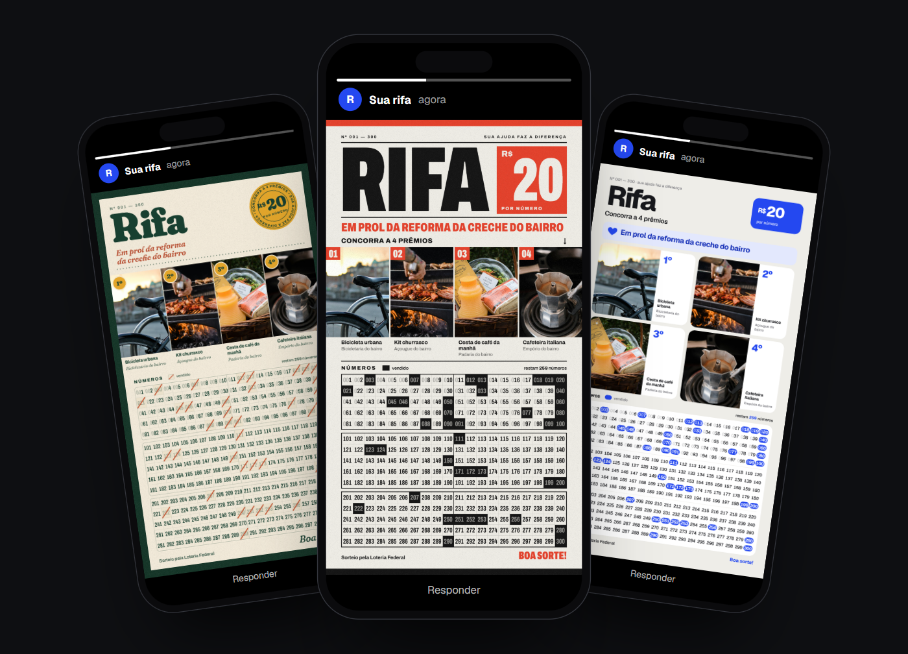
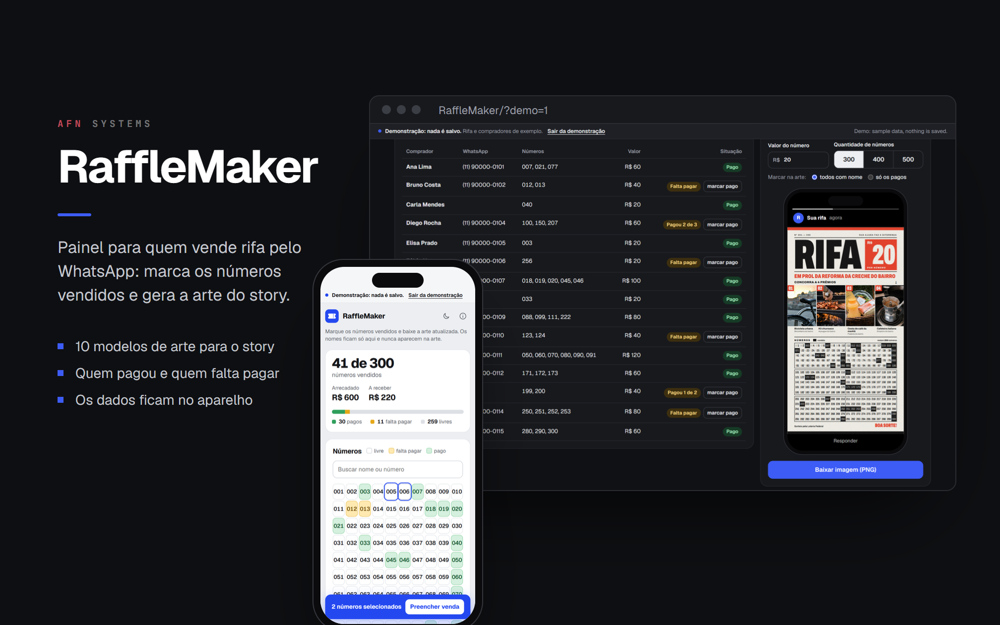
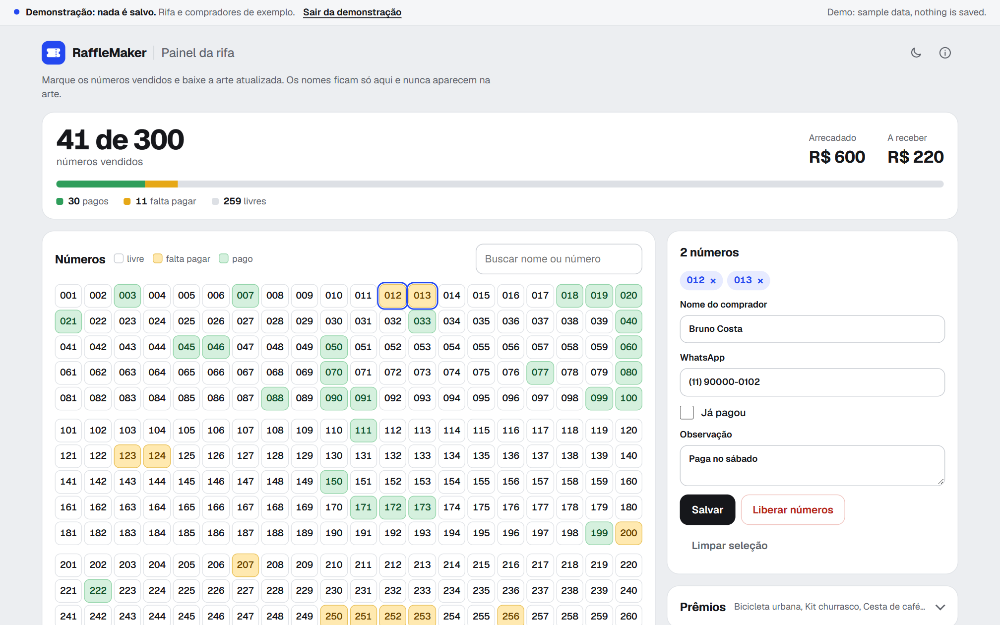
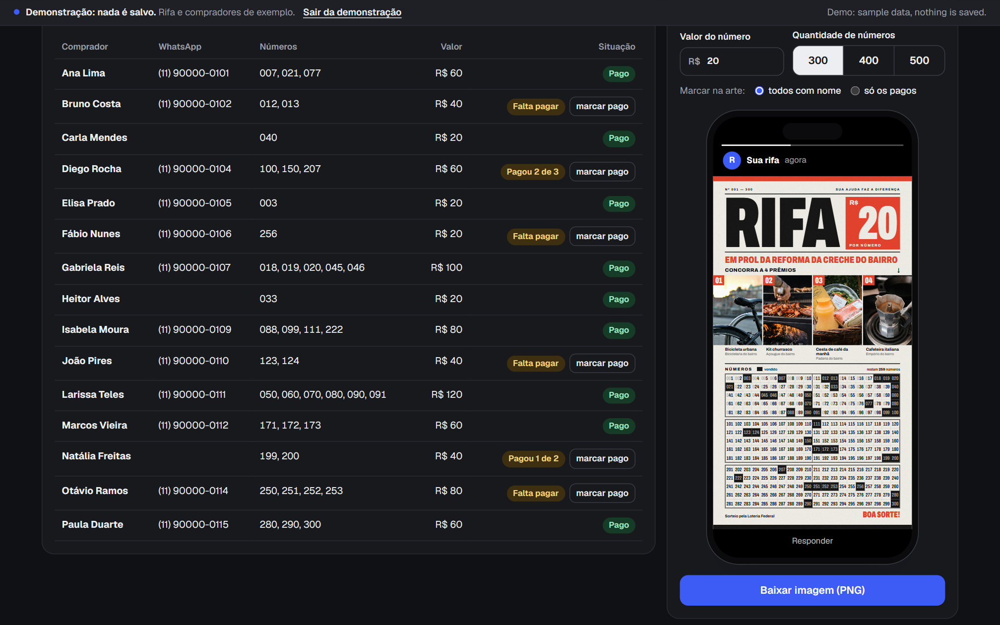
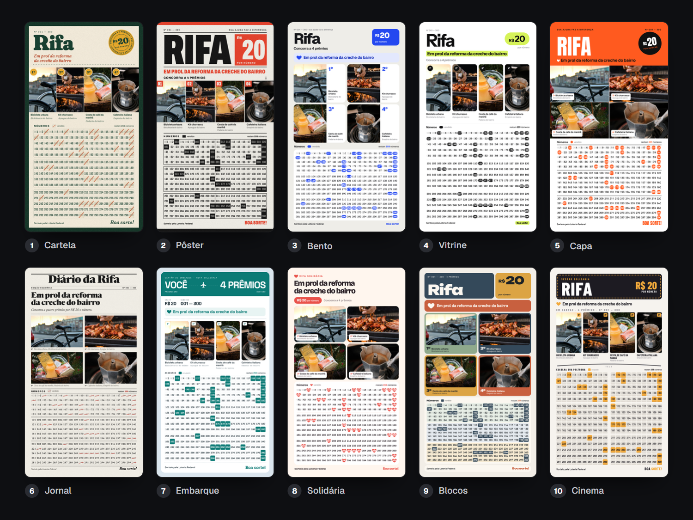
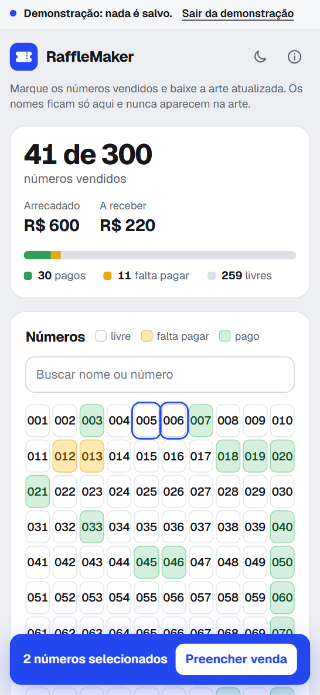

# RaffleMaker

A raffle panel for selling over WhatsApp: sold numbers, payments and the
story image, made for a real charity raffle in Brazil.



**[See the live demo](https://alyssom-fernandes.github.io/RaffleMaker/?demo=1)**: a
sample raffle with 15 buyers and 41 numbers sold, where nothing is saved. Or
[open an empty panel](https://alyssom-fernandes.github.io/RaffleMaker/).

RaffleMaker is the panel of a real charity raffle, organized by the author in
Brazil to help with someone's medical treatment: four prizes and 300 numbers
at R$ 20 each, sold over WhatsApp. After every sale the same questions come
up: which numbers are still free, who has paid and who has not, how much has
come in. The panel answers them in one place and makes the image for the
WhatsApp Status, in 10 models, with the sold numbers marked, ready to post
again after each sale. Buyers' names and phone numbers stay in the panel and
never go into the image.

It is a static site in plain JavaScript: one HTML page for the panel, ten
HTML models for the art and two scripts, with no framework, no build step and
no back end. What the user types and the photos they add stay in their
browser; only the fonts are loaded from Google Fonts. The interface is in
Portuguese.

[](https://github.com/alyssom-fernandes/RaffleMaker/actions/workflows/testes.yml)


This README is also available in [Portuguese](README.pt-BR.md).

## In 30 seconds

1. Open the [demo](https://alyssom-fernandes.github.io/RaffleMaker/?demo=1).
2. Click two free numbers in the grid (Shift + click selects a range), type a
   name and click **Salvar** (Save). The numbers turn yellow, or green if
   **Já pagou** (Paid) is ticked, and the totals at the top follow.
3. In **Arte para postar** (Art to post), pick one of the 10 models and click
   **Baixar imagem (PNG)** (Download image): you get a 1080 × 1920 story
   image with the sold numbers marked.

## Screenshots

Taken from the demo mode by `scripts/telas.py`.



| Panel, light theme | Panel, dark theme |
|---|---|
|  |  |
| **Clicking a buyer selects their numbers and opens the sale** | **Who has paid, and the art inside the Status frame** |

**The 10 models, exported by the panel with the demo data**



| On a phone |
|---|
|  |

## What it does

### Selling numbers

- A grid of 300, 400 or 500 numbers in blocks of 100, each free, **falta
  pagar** (not paid yet) or **pago** (paid). Click to select, Shift + click to
  select a range, Esc to clear.
- The sale: the buyer's name (suggested from earlier buyers, bringing their
  WhatsApp along), WhatsApp, paid or not, and a note. Giving someone a number
  that belongs to another buyer asks first; **Liberar números** (Free
  numbers) returns them to the grid.
- Search by name or number: the grid dims what does not match, and the
  buyers table is filtered.
- One line per buyer, with their numbers, the amount and the status (**Pago**,
  **Falta pagar**, or **Pagou 2 de 3**, paid 2 of 3), a **marcar pago** (mark
  paid) button and the WhatsApp number as a link to the chat. Clicking a line
  selects that buyer's numbers.
- At the top: how many numbers are sold, the money already in (paid numbers)
  and still to come, and a bar with paid, not paid and free.

### The art

- 10 models for the 1080 × 1920 story, each marking the sold numbers in its
  own way. **Marcar na arte** (Mark on the art) chooses between every number
  with a name or only the paid ones.
- The cause (up to 120 characters), a footer line (up to 90), the price per
  number (up to R$ 9.999,99) and the quantity of numbers come from the panel.
  Texts take the largest size that fits their lines; when the grid gets
  tight, the prize photos shrink, down to 75%, to make room.
- The 4 prizes, each with a name, a brand or donor, and a photo. Photos are
  reduced to a JPEG of up to 1080 px and kept on the device. A name too long
  for a model's lines gets a smaller font and, at the limit, an ellipsis.
- The preview is the art itself, inside a phone with the Status frame, and
  it changes as you type.
- On a computer, the PNG downloads straight away. On a phone, it opens in a
  window with **Baixar** (Download) and, where the browser can share files,
  **Compartilhar** (Share), which opens the system share sheet. The file name
  says the model, how many numbers are free and when it was made
  (`Rifa - Cartela - 259 livres - 29-10 14h05.png`).

### Data, backup and the demo

- Everything is saved in the browser as you go, and the header says when
  (**Salvo neste navegador às 14:05**, saved in this browser at 14:05). If
  saving fails, it says so in red and asks for a backup.
- **Salvar backup** (Save backup) downloads a JSON file with everything,
  prize photos included; **Restaurar** (Restore) reads it back, after checking
  the file and each photo. **Exportar para Excel** (Export to Excel) makes a
  spreadsheet with one line per number.
- The Backup card shows when the last backup was made and how many changes
  came after it, and stands out after 10.
- Data saved by older versions still opens: new versions only add fields,
  unknown fields are kept, and backups from every version restore.
- The demo (`?demo=1`) is a sample raffle that lives only in memory: it never
  reads or writes the saved data, the photos or the theme, its files come out
  with "demonstração" in the name, and the real panel refuses to restore a
  demo backup. Its sample phone numbers are not links, so no one gets a
  message by accident.

### Phone, themes and accessibility

- On a phone, the grid has 10 columns, the buyers table hides the WhatsApp
  and amount columns, and a bar at the bottom shows how many numbers are
  selected, with **Preencher venda** (Fill in the sale).
- Light and dark themes that follow the device until the user chooses, with
  no flash on load.
- Numbers, models and actions are real buttons, with visible focus, and the
  summary bar has a text description for screen readers. Honors "reduce
  motion" and the system's high contrast mode, where sold numbers also differ
  by their border.

## How it is built

| Part | Technology |
|---|---|
| Panel | HTML, CSS and JavaScript in `index.html`, no framework |
| Art | 10 HTML models of 1080 × 1920 (`arte/m01.html` to `m10.html`), filled in and fitted by `arte/motor.js` |
| PNG export | `arte/svgshot.js`: the art becomes an SVG of shapes, text and images, drawn on a canvas |
| Data | `localStorage` for the raffle, IndexedDB for the prize photos |
| Sharing | Web Share API with files |
| Fonts | Geist for the panel and JetBrains Mono for the signature; each art model has its own (Fraunces, Anton, Unbounded and others), all from Google Fonts |
| Security | Content Security Policy in a meta tag, with the inline script allowed by its SHA-256 hash |
| Tests | `node --test`, with no dependencies, and a browser test with Playwright; both run on every push (GitHub Actions) |

Some decisions behind it:

- **The art is HTML, and the PNG is drawn without `foreignObject`.** Each
  model is a 1080 × 1920 page that the panel shows in a frame and fills with
  the raffle's data, so the preview is the art itself. To make the file,
  `svgshot.js` rebuilds the art as an SVG made only of shapes, text and
  images, without the `foreignObject` that Safari blocks, and draws it on a
  canvas. A browser test compares the PNG of each of the 10 models with a
  screenshot of the same art and fails if the average difference goes over 4
  out of 255.
- **The demo cannot touch real data.** `carregar()` and `salvar()` (load and
  save) are the only two places that use `localStorage`, and both return early
  in the demo; the photos and the theme follow the same rule. The browser
  test records every access to storage during the demo, requires none, and
  checks that the saved data stays the same, byte for byte.
- **Saved data only grows.** New versions add fields and never rename them,
  and unknown fields are kept. Data from the first version is migrated (a
  phrase with "em prol", "in support of", becomes the cause). Without saved
  prizes, the panel keeps the 4 prizes of the original raffle, so the art of
  a raffle that is already running does not change.
- **The page only runs its own code.** The security policy allows the inline
  script by its hash, the site's own scripts and, from outside, only Google
  Fonts. A test recomputes the hashes, so changing a script without updating
  the policy fails the build instead of breaking the live page.

## Known limitations

- Fonts come from Google Fonts, so the browser contacts Google to fetch them
  (nothing typed or uploaded goes along).
- It has to be served over HTTP or HTTPS: opened straight from disk, the
  browser blocks access to the frame that holds the art and the reading of
  its files. Any static host works, such as GitHub Pages.
- GitHub Pages does not allow custom headers, so the security policy is set
  in a meta tag. That form cannot stop another site from embedding the page
  in a frame.
- **Compartilhar** (Share) needs HTTPS and a browser that can share files
  (Chrome on Android, Safari on iPhone). Elsewhere, **Baixar** (Download)
  does the job.
- Data stays in each device's browser: the phone and the computer do not see
  each other's sales. To keep them or move them, use **Salvar backup** and
  **Restaurar**. Clearing the site's data erases the raffle.
- The automated tests run on Chromium only (Edge on Windows, Chromium in the
  CI).
- The art is made for exactly 4 prizes and 300, 400 or 500 numbers.
- The interface is in Portuguese only. In the demo, the banner at the top also
  says in English, on wide screens, that the data is a sample.

## Running your own copy

1. Fork the repository and turn on GitHub Pages for the `main` branch, at the
   root. Any static host works; to try it on your computer, serve the folder
   with a local web server (opening `index.html` straight from disk does not
   work).
2. Open the panel and fill in the cause, the prizes, the price and the
   quantity of numbers. The art changes as you type, and everything stays in
   that browser.
3. The 10 models are in `arte/`. After changing one, `python
   scripts/miniaturas.py` redoes the thumbnails and `python scripts/telas.py`
   the images in this README (both need Playwright for Python with Microsoft
   Edge, and Pillow).

To run the tests (Node 22 or newer, nothing to install):

```bash
node --test
```

The browser test needs Playwright and Pillow:

```bash
pip install playwright pillow
playwright install chromium
python tests/e2e.py
```

On Windows, `PLAYWRIGHT_CANAL=msedge` makes it use the installed Edge instead.

## Project structure

```
index.html              the panel: numbers, buyers, prizes, art preview and backup
404.html                not-found page
favicon.svg             the ticket icon
arte/
  m01.html … m10.html   the 10 art models, 1080 × 1920
  motor.js              fills a model with the raffle's data and fits the text
  svgshot.js            turns the art into an SVG without foreignObject and draws the PNG
  fotos/                prize photos: the original raffle's and the demo's
  miniaturas/           thumbnails of the 10 models, shown in the panel
  grao.webp             grain texture used by three models
scripts/
  miniaturas.py         redoes the thumbnails (Playwright + Edge)
  telas.py              redoes the images in docs/telas from the demo
tests/
  puro.test.mjs         tests for the pure functions of the panel and of the art engine
  csp.test.mjs          checks that the security policy allows exactly the pages' scripts
  e2e.py                the panel in a real browser: demo, PNGs, backups and prizes
  fotos/                image used by the browser test
.github/
  workflows/testes.yml  runs both test suites on every push
  dependabot.yml        monthly updates for the GitHub Actions
docs/telas/             images used in this README and the link preview (og.png)
```

## License

[MIT](LICENSE), for the code. Made by
[Alyssom Fernandes](https://github.com/alyssom-fernandes), AFN Systems.

The prize photos in `arte/fotos/` are not covered by the MIT license. The demo
prizes use photos from [Unsplash](https://unsplash.com), under the
[Unsplash License](https://unsplash.com/license):

- Bicycle: [photo by Lopify](https://unsplash.com/photos/AoSAOV2Vtro)
- Barbecue kit: [photo by Marek Mucha](https://unsplash.com/photos/tAFWFWrWGyE)
- Breakfast basket: [photo by Freddie Collins](https://unsplash.com/photos/eLpnTMOHAkU)
- Moka pot: [photo by Aaron Simpson](https://unsplash.com/photos/xVvqC0pbvuM)
