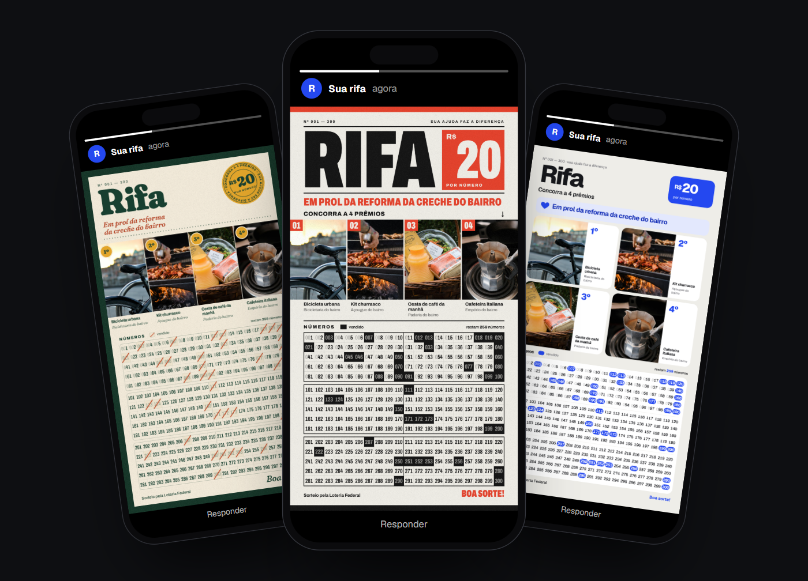
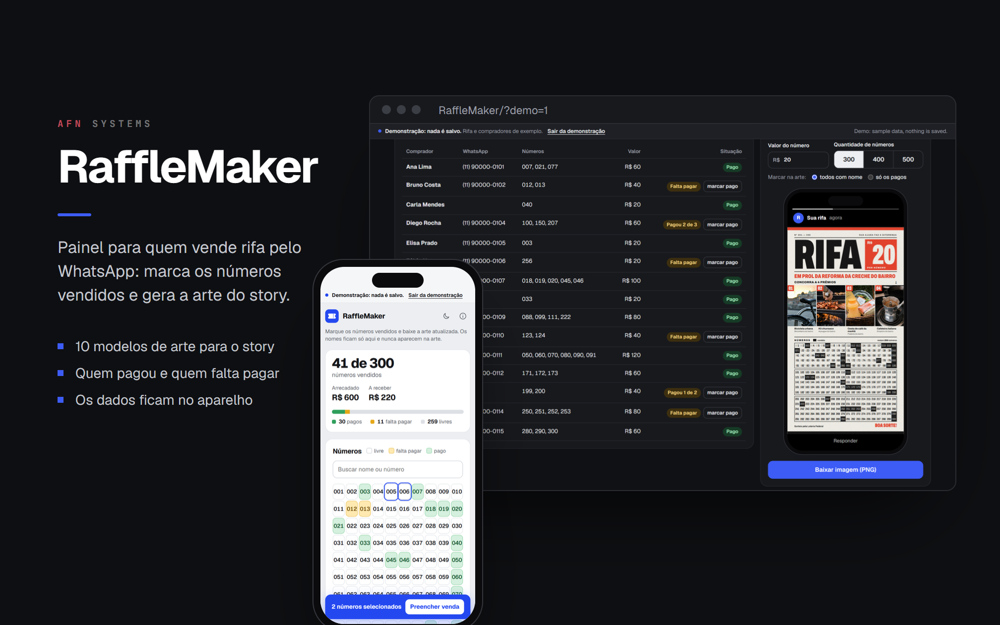
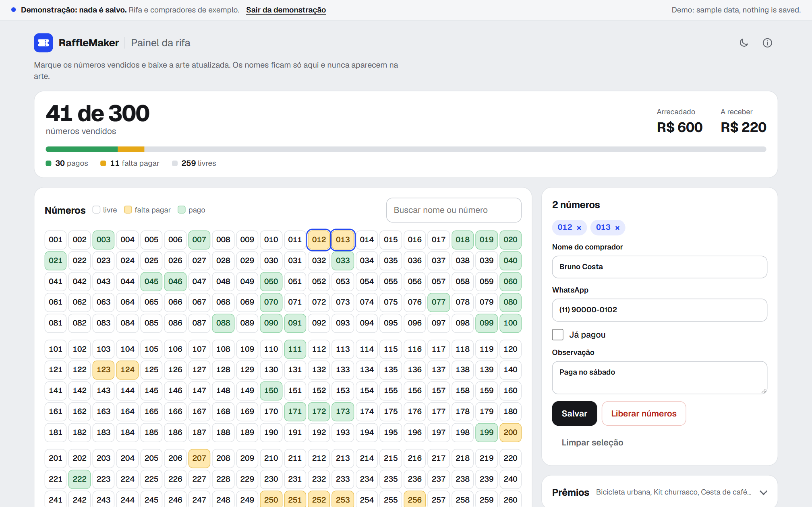
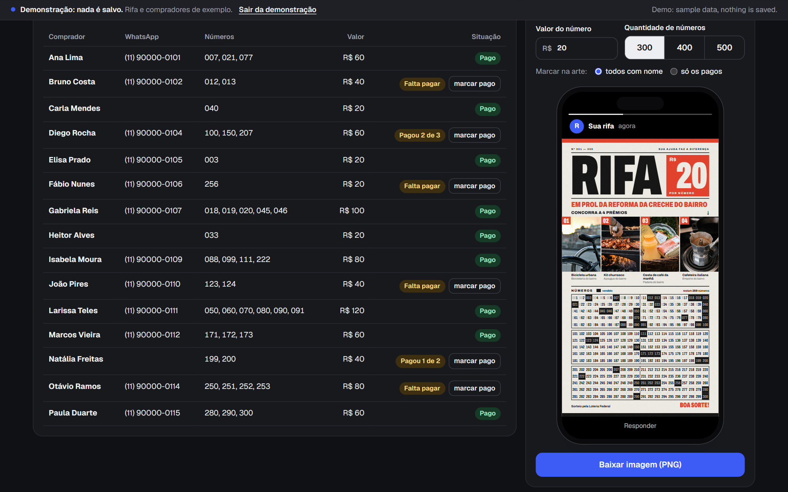
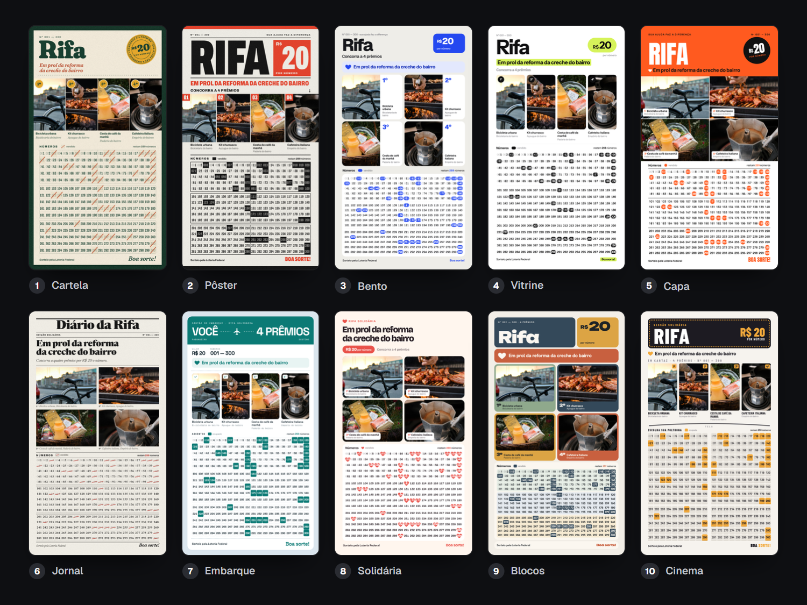
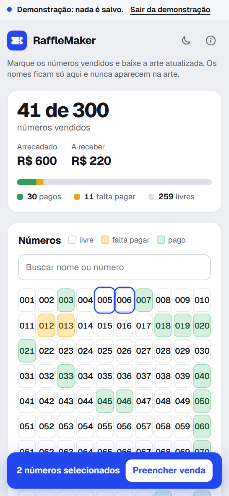

# RaffleMaker

Painel de rifa para quem vende pelo WhatsApp: números vendidos, pagamentos e
a arte do story, feito para uma rifa beneficente de verdade.



**[Ver a demonstração](https://alyssom-fernandes.github.io/RaffleMaker/?demo=1)**: uma
rifa de exemplo com 15 compradores e 41 números vendidos, em que nada é salvo.
Ou [abrir o painel vazio](https://alyssom-fernandes.github.io/RaffleMaker/).

O RaffleMaker é o painel de uma rifa beneficente de verdade, organizada pelo
autor para ajudar no tratamento de saúde de uma pessoa: quatro prêmios e 300
números a R$ 20, vendidos pelo WhatsApp. A cada venda voltam as mesmas
perguntas: quais números ainda estão livres, quem já pagou e quem não pagou,
quanto já entrou. O painel responde num lugar só e gera a imagem para o Status
do WhatsApp, em 10 modelos, com os números vendidos marcados, pronta para
postar de novo depois de cada venda. Os nomes e os telefones dos compradores
ficam no painel e nunca vão para a imagem.

É um site estático em JavaScript puro: uma página HTML para o painel, dez
modelos em HTML para a arte e dois scripts, sem framework, sem etapa de build e
sem back-end. O que se digita e as fotos ficam no navegador de quem usa; da
internet vêm só as fontes, do Google Fonts.

[](https://github.com/alyssom-fernandes/RaffleMaker/actions/workflows/testes.yml)


Este README também está em [inglês](README.md).

## Em 30 segundos

1. Abra a [demonstração](https://alyssom-fernandes.github.io/RaffleMaker/?demo=1).
2. Clique em dois números livres da grade (Shift + clique seleciona uma
   sequência), escreva um nome e clique em **Salvar**. Os números ficam
   amarelos, ou verdes se **Já pagou** estiver marcado, e os totais do topo
   acompanham.
3. Em **Arte para postar**, escolha um dos 10 modelos e clique em **Baixar
   imagem (PNG)**: sai uma imagem de 1080 × 1920 para o story, com os números
   vendidos marcados.

## Telas

Capturadas do modo demonstração pelo `scripts/telas.py`.



| Painel, tema claro | Painel, tema escuro |
|---|---|
|  |  |
| **Clicar num comprador seleciona os números dele e abre a venda** | **Quem já pagou, e a arte na moldura do Status** |

**Os 10 modelos, exportados pelo painel com os dados da demonstração**



| No celular |
|---|
|  |

## O que ele faz

### Vender os números

- Grade de 300, 400 ou 500 números em blocos de 100, cada um livre, **falta
  pagar** ou **pago**. Clique para selecionar, Shift + clique para uma
  sequência, Esc para limpar.
- A venda: nome do comprador (sugerido entre os que já compraram, trazendo o
  WhatsApp junto), WhatsApp, se já pagou e uma observação. Passar para alguém
  um número que é de outro comprador pede confirmação antes; **Liberar
  números** devolve os números à grade.
- Busca por nome ou número: a grade apaga o que não bate, e a tabela de
  compradores é filtrada.
- Uma linha por comprador, com os números, o valor e a situação (**Pago**,
  **Falta pagar** ou **Pagou 2 de 3**), o botão **marcar pago** e o WhatsApp
  como link para a conversa. Clicar na linha seleciona os números da pessoa.
- No topo: quantos números foram vendidos, o que já entrou (números pagos) e
  o que falta receber, e uma barra com pagos, falta pagar e livres.

### A arte

- 10 modelos para o story de 1080 × 1920, cada um marcando os números
  vendidos do seu jeito. **Marcar na arte** escolhe entre todos os números com
  nome ou só os pagos.
- A causa (até 120 caracteres), a frase do rodapé (até 90), o valor do número
  (até R$ 9.999,99) e a quantidade de números vêm do painel. Os textos ficam
  no maior tamanho que cabe nas linhas deles; quando a grade aperta, as fotos
  dos prêmios encolhem, até 75%, para dar espaço.
- Os 4 prêmios, cada um com nome, marca ou doador e foto. A foto é reduzida
  para um JPEG de até 1080 px e fica guardada no aparelho. Um nome longo demais
  para as linhas do modelo ganha uma fonte menor e, no limite, reticências.
- A prévia é a própria arte, dentro de um celular com a moldura do Status, e
  muda enquanto se digita.
- No computador, o PNG baixa direto. No celular, ele abre numa janela com
  **Baixar** e, onde o navegador compartilha arquivos, **Compartilhar**, que
  abre a folha de compartilhamento do sistema. O nome do arquivo diz o modelo,
  quantos números estão livres e quando foi feito
  (`Rifa - Cartela - 259 livres - 29-10 14h05.png`).

### Dados, backup e demonstração

- Tudo é salvo no navegador enquanto se usa, e o cabeçalho diz quando
  (**Salvo neste navegador às 14:05**). Se não der para salvar, ele avisa em
  vermelho e pede um backup.
- **Salvar backup** baixa um arquivo JSON com tudo, inclusive as fotos dos
  prêmios; **Restaurar** lê de volta, depois de conferir o arquivo e cada foto.
  **Exportar para Excel** gera uma planilha com uma linha por número.
- O cartão Backup mostra quando foi o último backup e quantas alterações
  vieram depois dele, e ganha destaque a partir de 10.
- Os dados salvos por versões antigas continuam abrindo: as versões novas só
  acrescentam campos, os campos desconhecidos são mantidos, e os backups de
  todas as versões restauram.
- A demonstração (`?demo=1`) é uma rifa de exemplo que existe só na memória:
  ela nunca lê nem grava os dados salvos, as fotos ou o tema, os arquivos dela
  saem com "demonstração" no nome, e o painel de verdade recusa restaurar um
  backup da demonstração. Os telefones de exemplo não viram link, para ninguém
  mandar mensagem por engano.

### Celular, temas e acessibilidade

- No celular, a grade tem 10 colunas, a tabela de compradores esconde as
  colunas de WhatsApp e valor, e uma barra embaixo mostra quantos números estão
  selecionados, com **Preencher venda**.
- Tema claro e escuro, seguindo o aparelho até alguém escolher, sem piscar na
  abertura.
- Números, modelos e ações são botões de verdade, com foco visível, e a barra
  do resumo tem descrição em texto para leitores de tela. Respeita "reduzir
  movimento" e o alto contraste do sistema, em que os números vendidos também
  se distinguem pela borda.

## Como é feito

| Parte | Tecnologia |
|---|---|
| Painel | HTML, CSS e JavaScript no `index.html`, sem framework |
| Arte | 10 modelos em HTML de 1080 × 1920 (`arte/m01.html` a `m10.html`), preenchidos e ajustados pelo `arte/motor.js` |
| Exportar o PNG | `arte/svgshot.js`: a arte vira um SVG de formas, textos e imagens, desenhado num canvas |
| Dados | `localStorage` para a rifa, IndexedDB para as fotos dos prêmios |
| Compartilhar | Web Share API com arquivo |
| Fontes | Geist no painel e JetBrains Mono na assinatura; cada modelo de arte tem as suas (Fraunces, Anton, Unbounded e outras), todas do Google Fonts |
| Segurança | Content Security Policy por meta, com o script inline liberado pelo hash SHA-256 |
| Testes | `node --test`, sem dependências, e um teste no navegador com Playwright; os dois rodam a cada envio (GitHub Actions) |

Algumas decisões por trás dele:

- **A arte é HTML, e o PNG é desenhado sem `foreignObject`.** Cada modelo é
  uma página de 1080 × 1920 que o painel mostra num quadro e preenche com os
  dados da rifa, então a prévia é a própria arte. Para gerar o arquivo, o
  `svgshot.js` refaz a arte como um SVG só de formas, textos e imagens, sem o
  `foreignObject` que o Safari bloqueia, e desenha num canvas. Um teste no
  navegador compara o PNG de cada um dos 10 modelos com a captura da mesma
  arte e falha se a diferença média passar de 4 em 255.
- **A demonstração não consegue mexer nos dados de verdade.** `carregar()` e
  `salvar()` são os dois únicos pontos que usam o `localStorage`, e os dois
  saem cedo na demonstração; as fotos e o tema seguem a mesma regra. O teste no
  navegador registra todo acesso ao armazenamento durante a demonstração, exige
  zero e confere que os dados salvos ficam iguais, byte a byte.
- **Os dados salvos só crescem.** As versões novas acrescentam campos e nunca
  mudam o nome deles, e os campos desconhecidos são mantidos. Os dados da
  primeira versão são migrados (a frase com "em prol" vira a causa). Sem
  prêmios salvos, o painel continua com os 4 prêmios da rifa original, para a
  arte de uma rifa já em andamento não mudar.
- **A página só roda o próprio código.** A política de segurança libera o
  script inline pelo hash, os scripts do próprio site e, de fora, só o Google
  Fonts. Um teste recalcula os hashes: mudar um script sem atualizar a política
  quebra o build, e não a página no ar.

## Limitações conhecidas

- As fontes vêm do Google Fonts, então o navegador fala com o Google para
  buscá-las (nada do que se digita ou das fotos vai junto).
- Precisa ser servido por HTTP ou HTTPS: aberto direto do disco, o navegador
  bloqueia o acesso ao quadro em que está a arte e a leitura dos arquivos dela.
  Qualquer hospedagem estática serve, como o GitHub Pages.
- O GitHub Pages não deixa mandar cabeçalhos próprios, então a política de
  segurança vai por meta. Desse jeito ela não impede outro site de embutir a
  página num quadro.
- **Compartilhar** precisa de HTTPS e de um navegador que compartilhe arquivos
  (Chrome no Android, Safari no iPhone). Nos outros, o **Baixar** resolve.
- Os dados ficam no navegador de cada aparelho: o celular e o computador não
  veem as vendas um do outro. Para guardar ou levar a outro aparelho, use
  **Salvar backup** e **Restaurar**. Limpar os dados do site apaga a rifa.
- Os testes automáticos rodam só no Chromium (Edge no Windows, Chromium no CI).
- A arte é feita para exatamente 4 prêmios e 300, 400 ou 500 números.
- A interface é só em português. Na demonstração, a faixa do topo também avisa
  em inglês, nas telas largas, que os dados são de exemplo.

## Como usar a sua cópia

1. Faça um fork do repositório e ligue o GitHub Pages na branch `main`, na
   raiz. Qualquer hospedagem estática serve; para testar no computador, sirva a
   pasta com um servidor web local (aberto direto do disco, o `index.html` não
   funciona).
2. Abra o painel e preencha a causa, os prêmios, o valor e a quantidade de
   números. A arte muda enquanto se digita, e tudo fica naquele navegador.
3. Os 10 modelos ficam em `arte/`. Depois de mudar um, `python
   scripts/miniaturas.py` refaz as miniaturas e `python scripts/telas.py` as
   imagens deste README (os dois precisam do Playwright para Python com o
   Microsoft Edge, e do Pillow).

Para rodar os testes (Node 22 ou mais novo, sem instalar nada):

```bash
node --test
```

O teste no navegador precisa do Playwright e do Pillow:

```bash
pip install playwright pillow
playwright install chromium
python tests/e2e.py
```

No Windows, `PLAYWRIGHT_CANAL=msedge` faz ele usar o Edge instalado.

## Estrutura

```
index.html              o painel: números, compradores, prêmios, prévia da arte e backup
404.html                página de endereço não encontrado
favicon.svg             o ícone do bilhete
arte/
  m01.html … m10.html   os 10 modelos de arte, 1080 × 1920
  motor.js              preenche o modelo com os dados da rifa e ajusta os textos
  svgshot.js            transforma a arte num SVG sem foreignObject e desenha o PNG
  fotos/                fotos dos prêmios: as da rifa original e as da demonstração
  miniaturas/           miniaturas dos 10 modelos, mostradas no painel
  grao.webp             textura de grão usada por três modelos
scripts/
  miniaturas.py         refaz as miniaturas (Playwright + Edge)
  telas.py              refaz as imagens de docs/telas a partir da demonstração
tests/
  puro.test.mjs         testes das funções puras do painel e do motor da arte
  csp.test.mjs          confere que a política de segurança libera só os scripts das páginas
  e2e.py                o painel num navegador de verdade: demonstração, PNGs, backups e prêmios
  fotos/                imagem usada pelo teste no navegador
.github/
  workflows/testes.yml  roda os dois grupos de testes a cada envio
  dependabot.yml        atualização mensal das GitHub Actions
docs/telas/             imagens deste README e a prévia de link (og.png)
```

## Licença

[MIT](LICENSE), para o código. Feito por
[Alyssom Fernandes](https://github.com/alyssom-fernandes), AFN Systems.

As fotos dos prêmios em `arte/fotos/` não entram na licença MIT. Os prêmios da
demonstração usam fotos do [Unsplash](https://unsplash.com), pela
[licença do Unsplash](https://unsplash.com/license):

- Bicicleta: [foto de Lopify](https://unsplash.com/photos/AoSAOV2Vtro)
- Kit churrasco: [foto de Marek Mucha](https://unsplash.com/photos/tAFWFWrWGyE)
- Cesta de café da manhã: [foto de Freddie Collins](https://unsplash.com/photos/eLpnTMOHAkU)
- Cafeteira italiana: [foto de Aaron Simpson](https://unsplash.com/photos/xVvqC0pbvuM)
